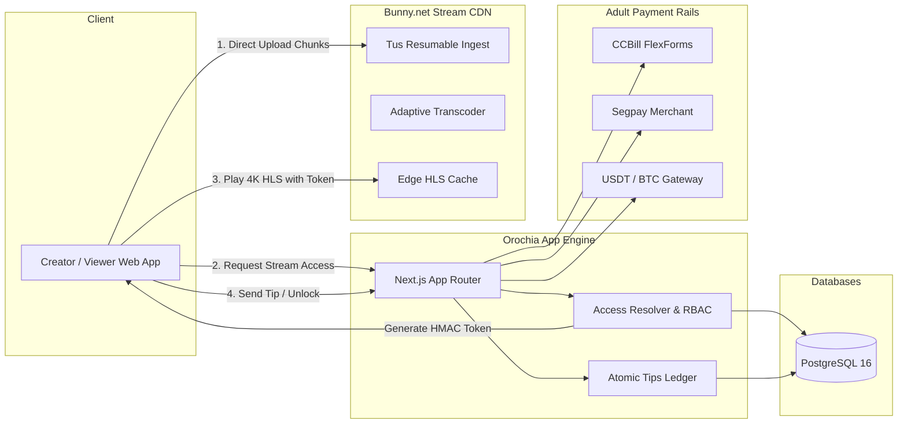

<!-- krizaka-header -->
<div align="center">

<picture>
  <source media="(prefers-color-scheme: dark)" srcset="https://raw.githubusercontent.com/krizaka/.github/main/profile/assets/orochia-dark.svg">
  
</picture>

# Orochia

**Creators get paid. Every cent, exactly once.**

The creator video platform: direct-to-CDN 4K streaming, server-side access control, gateway-confirmed payments settled exactly once on a double-entry ledger, and built-in 18+ compliance.

[](https://github.com/krizaka/orochia/actions/workflows/ci.yml)
[](LICENSE)
[](https://www.krizaka.com/en/products/orochia#guarantees)
[](https://www.krizaka.com/docs/orochia)

[Try it](https://dev.orochia.com) · [Documentation](https://www.krizaka.com/docs/orochia) · [Video tour](https://www.krizaka.com/en/products/orochia#tour) · [Website](https://www.krizaka.com) · [Krizaka on GitHub](https://github.com/krizaka)

</div>
<!-- /krizaka-header -->

<p align="center">
  <a href="https://www.krizaka.com/en/products/orochia#tour"></a>
  <br><sub>Alex opens Elena's story from her profile, likes it, replies privately and tips her — Elena keeps 90 % of it. More in the tour: Explore, unlocks, auctions, challenges, payouts. <a href="https://www.krizaka.com/en/products/orochia#tour">Full tour</a></sub>
</p>

Direct-to-CDN 4K streaming, an **Explorer** that is never empty,
complete **stories** (sound, likes, tips, private replies), audiences the creator chooses, **auctions** and
**challenges** paid in credits held in escrow until delivery. Creators keep **90 %**, settled once on a double-entry
ledger. Built-in 18+ compliance — on the web and on iOS and Android
([orochia-mobile](https://github.com/krizaka/orochia-mobile)).

---

## 🌟 Key Architectural Highlights

- 📺 **Direct-to-CDN media**: uploads go straight to Bunny Stream over Tus; playback uses HMAC-signed HLS URLs that expire after 5 minutes. Video never passes through the app servers.
- 🔐 **Server-side access control**: every play is authorised against the video's visibility — public, approved followers, contacts only, or paid unlock — before a URL is signed.
- 💳 **Gateway-confirmed payments**: an unlock records a payment intent and sends the buyer to CCBill, Segpay, NowPayments (crypto) or Stripe; access is granted only when the gateway's signed webhook confirms it, exactly once.
- 🔨 **Video auctions** ([docs/AUCTIONS.md](docs/AUCTIONS.md)): bids in credits held while they lead and released the moment they are outbid, anti-sniping soft close, the creator accepts or declines (or sells to the highest bid), and only the winner watches or downloads — pushed in real time over PostgreSQL LISTEN/NOTIFY and Server-Sent Events, no broker.
- 🔥 **Challenges** ([docs/CHALLENGES.md](docs/CHALLENGES.md)): goals, dares and open calls — fans put credits behind what they want to see, held in escrow until the video or story is delivered and returned when it is not. Nobody pays for nothing.
- 📖 **Stories**: a complete viewer — sound, gestures, likes, private replies, tips and reports — opened from the ring on a creator's profile.
- 🧭 **Explorer**: discovery that is never empty — sections, full-text search, normalised tags, public videos only.
- 💸 **90 % to the creator**: the platform fee (10 % by default, `PLATFORM_FEE_PERCENTAGE`) and the creator's credit are written once, together, on the ledger.
- 🤝 **Social graph**: creators approve their followers (followers-only videos), people become mutual contacts (contacts-only videos); public and private playlists.
- 🧹 **Moderation**: operators take videos down with a recorded reason (and restore them), suspend accounts with immediate effect, change roles — from the admin console.
- 📒 **Double-entry ledger**: platform fee and creator credit always add up to the gross; balances are computed from the ledger; concurrent payout requests are serialised.
- 🛡️ **18 U.S.C. § 2257 & safety**: 18+ certification at sign-up, creator verification before upload, persisted content reports (non-consensual content, suspected minors, DMCA).
- 🚦 **Fail-closed configuration**: production refuses to run on missing secrets and has no demo mode; security headers (HSTS, frame denial, nosniff) on every response.
- 🚀 **Deployable**: multi-stage Docker image with a bundled migrator, DigitalOcean App Platform spec with a PRE_DEPLOY migration job, CI with lint, typecheck, tests, build and migrations on PostgreSQL 16.

---

## 🏗️ Architecture Topology



---

## 📦 Monorepo Structure

```text
orochia
├── .github/
│   ├── workflows/ (ci.yml, release.yml)
│   └── ISSUE_TEMPLATE/ (bug_report.yml, feature_request.yml)
├── apps/
│   └── web/ (Next.js 16 App Router, HLS Video Player, Creator Studio, Payouts)
├── packages/
│   ├── db/ (Drizzle ORM schema, PostgreSQL migrations, Seed factory)
│   ├── media/ (Bunny.net Stream SDK wrapper, Tus signing, HMAC token auth)
│   ├── payments/ (CCBill, Segpay, Crypto, Stripe adapters, Double-entry ledger)
│   └── config/ (Shared ESLint, TypeScript, and Tailwind configurations)
├── deploy/
│   ├── docker/ (Multi-stage Dockerfile, docker-compose.dev.yml, docker-compose.prod.yml)
│   └── digitalocean/ (app-spec.dev.yaml · app-spec.production.yaml — one App Platform app per environment)
├── docs/
│   ├── ARCHITECTURE.md
│   ├── MEDIA_PIPELINE.md
│   └── DEPLOYMENT.md
├── README.md
└── LICENSE
```

---

## 🚀 Quickstart

```bash
git clone https://github.com/krizaka/orochia.git && cd orochia
npm install
npm run setup     # .env · PostgreSQL 16 (Docker) · migrations · seed
npm run dev       # http://localhost:3000
```

Everything else — accounts of the seed, database commands (`db:status`, `db:reset`, `db:studio`, backups), schema
changes, tests — is in the [Development guide](docs/DEVELOPMENT.md). Rules: [AGENTS.md](AGENTS.md).

| Reference | Generated from |
| :--- | :--- |
| [API](docs/API_CONTRACTS.md) — every endpoint and its access rule | the route handlers |
| [Database](docs/DATABASE.md) — tables, indexes, foreign keys, enums | the Drizzle schema |

---

## ☁️ 1-Click Deploy to DigitalOcean

Deploy to DigitalOcean App Platform with a PostgreSQL 16 database — one app per environment (see [Deployment](docs/DEPLOYMENT.md)):

[](https://cloud.digitalocean.com/apps/new?repo=https://github.com/krizaka/orochia/tree/main)

Alternatively, deploy using `doctl`:
```bash
doctl apps create --spec deploy/digitalocean/app-spec.dev.yaml
```

---

## 📜 Roadmap

| Milestone | Status |
| :--- | :--- |
| M1 · Foundation & data — PostgreSQL schema, Drizzle, RBAC | ✅ shipped |
| M2 · Media pipeline — direct Tus uploads, signed webhooks, HLS player | ✅ shipped |
| M3 · Social graph & access control — approved followers, contacts, visibility matrix | ✅ shipped |
| M4 · Paywall & tips — gateway-confirmed intents, double-entry ledger, payouts | ✅ shipped |
| M5 · Community — playlists, explore search & tags | ✅ shipped · recommendations next |
| M6 · Developer experience & delivery — one-command setup, DB tooling, e2e, DigitalOcean | ✅ shipped |
| M7 · Auctions & challenges — escrowed credits, real-time pots, goals, dares and open calls | ✅ shipped |
| M8 · Mobile — [orochia-mobile](https://github.com/krizaka/orochia-mobile) for iOS and Android (Expo), native sessions | ✅ preview |

---

## 📄 License

Licensed under the [Apache License, Version 2.0](LICENSE).  
Copyright (c) 2026 Krizaka Organization.
